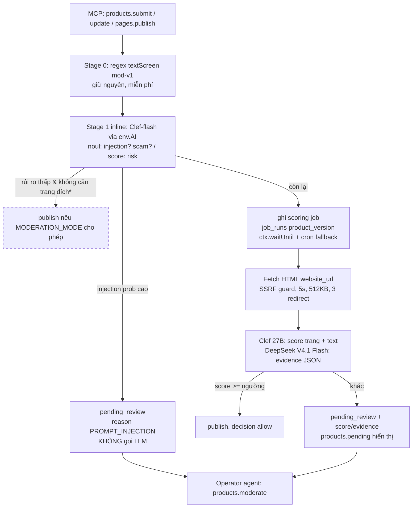

# Advice: lớp chấm điểm AI và auto-approve sản phẩm (bip.ad)

Ngày: 2026-11-09 (Asia/Saigon). Workflow: ak-advise (advisor agent). Advisory-only, không sửa code.

## Needs from you

1. **Xác nhận preview.** Orchestrator yêu cầu đi thẳng tới advice nên bước xác nhận preview bị bỏ qua; sơ đồ ở mục "Preview" bên dưới là reframing tôi đang dựa vào. Nếu nó lệch với hình dung của bạn, nói chỗ lệch trước khi plan.
2. **Chọn ngưỡng auto-approve bằng dữ liệu, không bằng cảm tính.** Khuyến nghị: chạy *shadow mode* trên production 1-2 tuần (chấm điểm, ghi log, nhưng không publish) rồi mới bật auto-approve với ngưỡng rút từ so sánh với quyết định của operator. Bạn quyết định độ dài giai đoạn shadow.

## Reframing (đã chốt từ interview)

**Vấn đề.** Screen hiện tại trong `src/domain/products.ts` là regex (`textScreen`: vài từ khoá cờ bạc + 4 cụm prompt-injection), chỉ trả `allow|defer`, bị vượt qua dễ dàng, và trên production mọi submission/edit đều chờ operator duyệt tay. Cần một lớp chấm điểm có hiểu ngữ nghĩa để (a) chặn scam/fraud/prompt-injection, (b) tự publish những sản phẩm rõ ràng an toàn, (c) đưa phần còn lại cho operator kèm điểm và lý do.

**Yêu cầu.**
1. Chấm lại ở cả 3 entry point hiện có: `submitProduct`, `updateProduct` (sản phẩm đã published), `publishPage`; kết quả gắn với `products.version` tại thời điểm chấm.
2. Stage 1 (decision model, inline trong tool call): phát hiện prompt injection và scam/rủi ro rõ ràng trên text builder gửi; nội dung bị gắn cờ injection **không bao giờ** được đưa vào LLM.
3. Stage 2 (async): tải HTML trang đích `website_url` server-side (chưa tải ảnh), chấm bằng decision model + LLM (DeepSeek V4.1 Flash) để sinh bằng chứng có cấu trúc cho operator.
4. Production: điểm cao vượt ngưỡng thì publish ngay; còn lại vào `pending_review` với điểm + lý do hiển thị trong `products.pending`. Không auto-reject.
5. Mọi quyết định máy ghi vào `decision_logs` với policy version mới; operator vẫn có quyền quyết định cuối (`products.moderate` với pin version).

**Mục tiêu.** Operator trên prod chỉ phải chạm vào phần nghi ngờ; scam/injection không lên board; builder lành tính được publish trong vài phút thay vì chờ người.

**Done means.**
- `products.submit` / `products.update` / `pages.publish` đều tạo bản ghi điểm cho đúng `product_version`, kiểm chứng bằng test trong vitest-pool-workers với Workers AI được stub.
- Trên prod, sản phẩm có verdict `allow` đủ ngưỡng được publish không cần operator; sản phẩm có `PROMPT_INJECTION` hoặc điểm thấp nằm trong `products.pending` kèm `score`, `reasons`, `evidence`.
- `operator.decisions` cho thấy entry `policy_version = mod-v2` cho mỗi lần chấm.
- Staging giữ hành vi hiện tại (auto-approve khi screen pass) hoặc chạy đủ pipeline với ngưỡng thấp — chọn một và ghi vào README.

**Non-goals.** Auto-reject; phân tích ảnh/screenshot; render JS (Browser Rendering); fine-tune model; OpenCode Go; xây hệ thống queue riêng.

**Constraints.** Chỉ MCP tạo/sửa sản phẩm (ADR-0006); text sản phẩm và HTML trang đích là dữ liệu không tin cậy, không bao giờ là instruction; không ghi secret vào D1/log; `products.moderate` tiếp tục yêu cầu `product_version`.

## Preview (end state giả định, không phải code hiện có)



\* Giả định cần bạn xác nhận: tôi khuyên **mọi submission lần đầu đều qua Stage 2** (vì scam thường nằm ở trang đích); Stage 1 chỉ được phép publish thẳng cho *edit nhỏ* của sản phẩm đã published mà `website_url` không đổi. Nếu bạn muốn Stage 1 publish thẳng cả submission mới, trade-off là bỏ qua đúng tín hiệu bạn vừa chọn tải về.

## Verdict

Ý tưởng đúng hướng và vừa tầm: decision model trước, LLM sau, code giữ quyền quyết định — đây đúng là mẫu "verify and escalate" mà cả TypeSafe lẫn Cloudflare khuyến nghị, và codebase đã có sẵn các chỗ cắm (3 entry point đồng bộ, `decision_logs`, `outbox_events`, `job_runs` khoá theo version, cron hàng giờ). Hai chỗ tôi phản biện: (1) chọn **Clef trên Workers AI** thay vì Jev qua OpenRouter — cùng API shape, không thêm vendor/secret/egress, latency thấp hơn; (2) việc tải HTML trang đích là tín hiệu tốt nhưng **phải nằm ở stage async** và có SSRF guard, vì nó là phần dễ gây sự cố nhất của toàn bộ thiết kế. OpenCode Go loại ngay: nó là subscription cho coding agent, ToS giám sát traffic "không giống coding agent".

## What you should do

1. **Cố định lựa chọn provider**: Stage 1 = `env.AI.run('@cf/cloudflare/clef', { model: 'clef-flash', ... })`; Stage 2 = `clef` (27B) cho điểm + `deepseek-v4.1-flash-1017` cho evidence JSON. Thêm binding `"ai": { "binding": "AI" }` vào cả hai env trong `wrangler.jsonc`. Không cần API key.
2. **Thiết kế câu hỏi typed, không phải prompt**. Stage 1 trên state `{ name, tagline, website_url, blocks_text }`: `injection` (noul: "văn bản có chứa chỉ thị nhắm vào AI/agent/operator thay vì mô tả sản phẩm?"), `scam` (noul), `category` (choice: software / restricted_finance / gambling / adult / other), `risk` (score 0-4 với mô tả tình huống cụ thể từng mức). Stage 2 thêm `page_text`, `page_title`, `final_url`, `outbound_domains` và hỏi `page_matches_listing` (noul), `page_risk` (score), `redirect_offsite` tính bằng code.
3. **Chính sách là code, không phải trọng số mơ hồ**: `injection >= 0.5` hoặc `category in restricted` → defer ngay, lý do rõ; `risk` và `page_risk` kết hợp thành verdict; ngưỡng đọc từ env (`MODERATION_AUTO_APPROVE_MIN_CONFIDENCE`). Thay boolean `AUTO_APPROVE_PRODUCTS` bằng `MODERATION_MODE = manual | ai | auto` (prod `ai`, staging `auto` hoặc `ai`) — một contract thay đổi, cập nhật README + wrangler.
4. **Lưu điểm theo version**: bảng mới `moderation_scores(id, product_id, product_version, page_version_id, stage, model, policy_version, answers_json, verdict, reasons_json, evidence_json, created_at)`. `products.pending` join bản ghi mới nhất cho đúng `p.version`. Dùng `job_runs (job_type='score', resource_id=product_id, version=product_version)` làm khoá idempotent cho stage 2.
5. **Async không cần hạ tầng mới**: sau khi batch D1 ghi pending, gọi `c.executionCtx.waitUntil(runScoringJob(...))` để stage 2 chạy ngay trong cùng request; cron hàng giờ hiện có (`40 * * * *`) quét `job_runs` dang dở làm fallback. Khi stage 2 xong và verdict `allow` đủ ngưỡng, publish bằng chính `approvePageStatements` hiện có với actor `system:ai-moderation` và guard `version = ?` (giống `moderateProduct`) để không publish nhầm bản đã bị sửa trong lúc chấm.
6. **Fetch HTML an toàn**: chỉ `https:`, từ chối hostname là IP literal / `localhost` / `*.internal` / origin của chính bip.ad; `redirect: 'manual'`, tối đa 3 hop, kiểm tra lại từng hop; timeout 5s; chỉ `text/html`; đọc tối đa 512 KB; bỏ `<script>/<style>`, lấy title, meta description, text hiển thị, danh sách domain outbound; lưu `content_sha256` và `final_url`. Gửi text đã cắt (~8k token) cho model.
7. **Shadow mode trước, auto-approve sau**: deploy với `MODERATION_MODE=manual` nhưng vẫn chấm và lưu điểm; sau 1-2 tuần so `verdict` với `products.moderate` của operator, chọn ngưỡng sao cho false-allow ≈ 0 trên tập đó, rồi chuyển `ai`.
8. **Giữ regex mod-v1 làm stage 0** — miễn phí, deterministic, và là fallback khi Workers AI lỗi (lỗi AI → defer, không bao giờ allow).

## What you shouldn't do

- Đừng dùng **OpenCode Go** làm backend: subscription $10/tháng cho coding agent, yêu cầu UA riêng và `x-opencode-session`, traffic bị giám sát; DeepSeek còn cần bật region "Global". Rủi ro bị khoá tài khoản giữa chừng.
- Đừng để **LLM free-text quyết định publish**. DeepSeek chỉ sinh `evidence` (claims, red flags, tóm tắt) cho operator; verdict chỉ đến từ các câu hỏi typed của Clef + luật code. Đây cũng là lý do injection phải được chặn trước LLM.
- Đừng **auto-reject** ở giai đoạn này: false-reject đuổi builder đi và cần đường kháng nghị chưa có.
- Đừng xây **provider abstraction** (registry/adapter cho Clef vs Jev). API shape giống nhau; nếu phải chuyển sang Jev qua OpenRouter chỉ cần đổi lời gọi `env.AI.run` thành `fetch('https://openrouter.ai/api/v1/systemone')` trong một hàm `askDecisionModel`. Một seam hàm là đủ.
- Đừng thêm **Cloudflare Queues / Durable Objects** cho stage 2; `waitUntil` + `job_runs` + cron hiện có là đủ cho khối lượng MVP.
- Đừng chạy fetch HTML **inline** trong tool call hay trong D1 batch: 1-5 giây mạng ngoài + retry sẽ làm MCP call chậm và lỗi chập chờn.
- Đừng gửi HTML thô vào model: cắt text, bỏ script, giới hạn token; 65k ctx của Clef không phải lý do để nhồi.
- Đừng phân tích ảnh/`image_url` bây giờ (đã là non-goal); Clef có vision nên bật sau rất dễ.

## What could be better / more efficient

1. (Rẻ, tác động lớn) **Edit nhỏ không đổi `website_url`** của sản phẩm đã published chỉ cần stage 1; tránh fetch lại trang mỗi lần sửa tagline.
2. (Rẻ) Cache kết quả fetch theo `(final_url, content_sha256)` 24h để re-score khi edit text không tốn fetch.
3. (Trung bình) Thêm `llama-guard-3-8b` (có sẵn trên Workers AI) làm tín hiệu phụ cho nội dung độc hại nếu Clef tỏ ra yếu ở mảng này — chỉ sau khi có dữ liệu shadow.
4. (Trung bình) Expose `moderation.rescore(product_id)` trên operator MCP để chấm lại thủ công sau khi đổi policy version.

## My take and how to get there

Làm theo thứ tự: migration `moderation_scores` + `MODERATION_MODE` → hàm `askDecisionModel` + stage 1 nối vào 3 entry point (test với AI stub) → fetcher HTML có SSRF guard (test riêng, nhiều case redirect/IP) → stage 2 job với `job_runs` + `waitUntil` + cron fallback → `products.pending` hiển thị điểm → deploy shadow (`manual`) → đo → bật `ai` trên prod. ADR mới (0008) ghi lại quyết định provider, ngưỡng, và quy tắc "AI lỗi thì defer".

## Benefits

- Operator trên prod chỉ xem phần vùng xám; builder lành tính được publish tự động trong vài phút.
- Injection được chặn ở lớp typed, không đi vào LLM hay operator agent — khớp mục tiêu security.
- Chi phí gần như bằng 0: ~3-10k token/sản phẩm × $0.24/M (Clef) + DeepSeek Flash tương đương vài phần mười cent; không thêm vendor, secret hay egress.
- Mọi quyết định có `policy_version`, `product_version`, và bằng chứng — audit được và re-score được.

## Trade-offs

- **Tải HTML trang đích (quyết định của bạn, tôi đã khuyên hoãn)**: thêm bề mặt SSRF/abuse cần test kỹ, thêm 1-5s latency ở stage async, và cloaking (trang hiển thị khác cho bot) hay trang JS-only sẽ qua mặt — bạn nhận được tín hiệu scam quan trọng nhất nhưng không phải tín hiệu hoàn hảo. Ghi rõ trong evidence khi fetch thất bại/ít text để operator biết.
- **Clef thay vì Jev**: khoá vào Cloudflare (dù API shape tương thích và weights Apache-2.0). Nếu chất lượng Clef trên tiếng Việt/scam kém hơn Jev trong shadow data, chuyển sang OpenRouter chỉ tốn một hàm và một secret.
- **Auto-approve trên prod**: chấp nhận một tỷ lệ false-allow; giảm bằng shadow mode và ngưỡng bảo thủ. Điều kiện dừng: nếu sau khi bật `ai` có >1 scam/tuần lên board, hạ về `manual` (một biến env, không cần deploy).
- **Thay đổi contract env** (`AUTO_APPROVE_PRODUCTS` → `MODERATION_MODE`): sửa wrangler, README, CI env.

## Unverified

- Giá `clef-flash` và `deepseek-v4.1-flash-1017` trên Workers AI: trang model Cloudflare chỉ ghi $0.24/M cho `clef`; giá DeepSeek lấy từ catalog bên thứ ba (~$0.44/$1.32 per M cho v4-flash). Xác nhận tại developers.cloudflare.com/workers-ai/platform/pricing trước khi ước lượng ngân sách.
- Độ chính xác của Clef với tiếng Việt và với nội dung scam: Cloudflare chỉ công bố benchmark nội bộ. Shadow mode là cách xác minh.
- Workers `fetch()` có tự chặn IP nội bộ hay không: tôi không dựa vào điều đó; SSRF guard ở mục 6 là bắt buộc bất kể.
- `env.AI.run` có bị tính vào giới hạn subrequest / CPU time của Worker khi chạy trong `waitUntil` ở mức tải cao: cần đo trong staging.

## Work checklist

- [ ] Migration `0003_moderation_scores.sql`: bảng `moderation_scores`; không đổi bảng cũ.
- [ ] `wrangler.jsonc`: thêm `ai` binding ở top-level và `env.production`; thay `AUTO_APPROVE_PRODUCTS` bằng `MODERATION_MODE` + `MODERATION_AUTO_APPROVE_MIN_CONFIDENCE`; cập nhật `src/env.ts`, `src/domain/config.ts`, README, `.dev.vars.example`.
- [ ] `src/domain/moderation-decision-model.ts`: `askDecisionModel(env.AI, model, state, questions)` + định nghĩa câu hỏi stage 1/stage 2 + hàm policy `verdictFrom(answers)`; `MODERATION_POLICY_VERSION = 'mod-v2'`.
- [ ] Nối stage 1 vào `submitProduct`, `updateProduct`, `publishPage`; lỗi AI → defer với reason `AI_UNAVAILABLE`; ghi `decision_logs`.
- [ ] `src/domain/landing-page-fetcher.ts`: SSRF guard, redirect manual ≤3, timeout 5s, 512KB, text extraction, `content_sha256`; test các case IP literal, localhost, redirect sang http, body quá lớn.
- [ ] `src/domain/moderation-scoring-job.ts`: stage 2 dùng `job_runs` làm khoá, publish qua `approvePageStatements` với guard version, actor `system:ai-moderation`.
- [ ] Gọi job qua `c.executionCtx.waitUntil` sau tool call; thêm quét job dang dở vào `scheduledJob`.
- [ ] `products.pending` trả `score`, `verdict`, `reasons`, `evidence`, `page_final_url`; `operator-server.ts` thêm `moderation.rescore`.
- [ ] Tests: stub `env.AI` trong vitest-pool-workers; case injection, scam rõ, lành tính, AI lỗi, version thay đổi trong lúc chấm.
- [ ] ADR-0008 về AI moderation; deploy shadow (`manual`) → đo → bật `ai`.

## Success metrics

- Tỷ lệ submission trên prod được publish tự động không cần operator ≥ 60% sau khi bật `ai` (đo từ `decision_logs` actor `system:ai-moderation`, decision `allow`).
- False-allow: 0 sản phẩm bị operator `suspend` trong 30 ngày đầu mà trước đó AI đã `allow`.
- Mọi test-string prompt-injection trong bộ test nội bộ (≥ 30 mẫu, gồm tiếng Việt) bị chặn ở stage 1: 100%.
- Thời gian từ `products.submit` tới publish cho sản phẩm an toàn < 2 phút (p95) ở stage 2.
- p95 latency `products.submit` tool call tăng < 400 ms so với trước.
- Chi phí Workers AI < $5/tháng ở khối lượng hiện tại (Cloudflare dashboard).

## Handoff brief

```text
Objective: Thêm lớp chấm điểm AI hai tầng (Clef-flash inline → Clef + DeepSeek V4.1 Flash async, có fetch HTML trang đích) cho mọi products.submit/update/pages.publish, lưu điểm theo product_version, auto-publish trên prod khi vượt ngưỡng, còn lại vào pending_review kèm điểm cho operator.
Done means: 3 entry point đều tạo moderation_scores đúng version (test với AI stub pass); injection/điểm thấp vào products.pending với score+reasons+evidence; verdict allow đủ ngưỡng publish không cần operator khi MODERATION_MODE=ai; decision_logs có policy mod-v2; AI lỗi => defer; README + wrangler + ADR-0008 cập nhật; pnpm typecheck && pnpm test pass.
Out of scope: auto-reject; phân tích ảnh; Browser Rendering/JS render; fine-tune; OpenCode Go; Queues/Durable Objects; provider abstraction layer.
Constraints: chỉ MCP sửa sản phẩm; text sản phẩm và HTML là dữ liệu không tin cậy; LLM chỉ sinh evidence, không quyết định publish; products.moderate vẫn yêu cầu product_version; publish tự động phải guard version như moderateProduct; SSRF guard bắt buộc cho fetch; không ghi secret vào D1/log; deploy lần đầu với MODERATION_MODE=manual (shadow).
Stop and ask only if: cần xoá/ghi đè dữ liệu hiện có; Workers AI binding không hoạt động trong vitest-pool-workers và cần đổi kiến trúc test; phát hiện Workers AI không gọi được từ waitUntil ở mức cần thiết; thay đổi ngoài phạm vi repo này.
```

## Unresolved questions

- Staging chạy `auto` (giữ hành vi cũ) hay `ai` với ngưỡng thấp để test pipeline thật?
- Submission mới có được stage 1 publish thẳng không, hay bắt buộc qua stage 2 (khuyến nghị bắt buộc)?
- Độ dài shadow mode trên prod trước khi bật `ai`.
